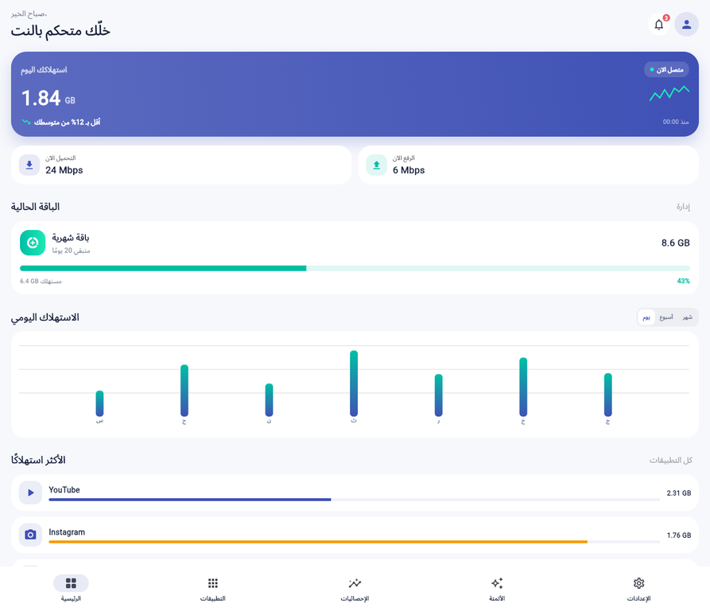
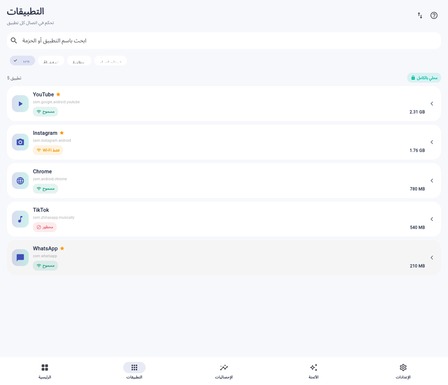
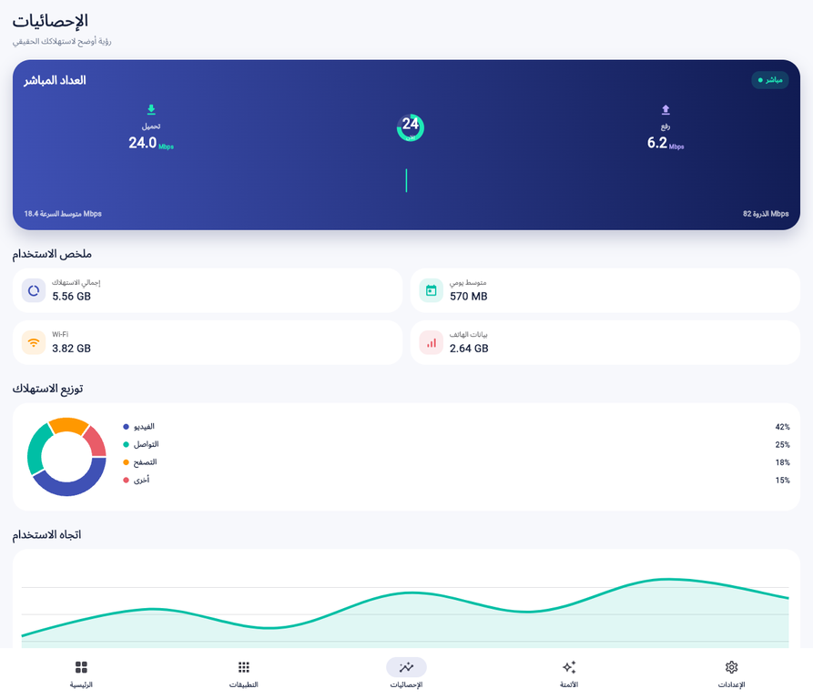
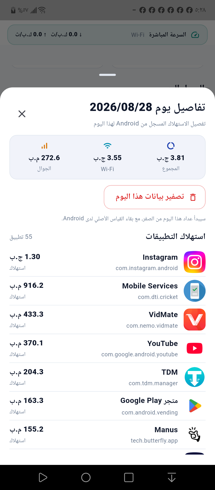
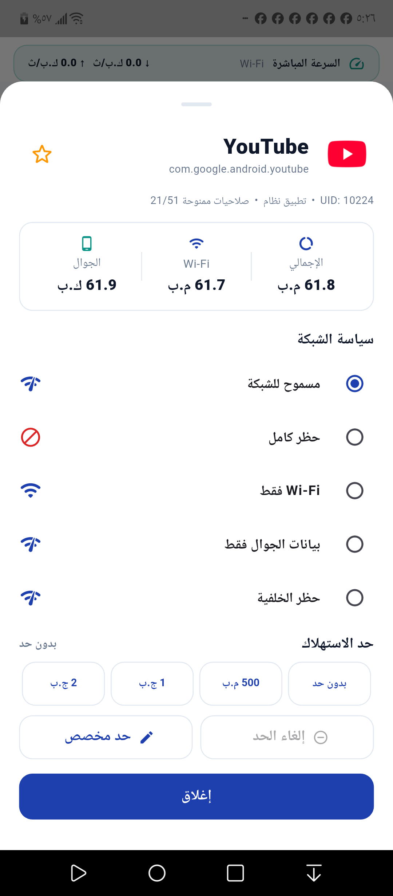
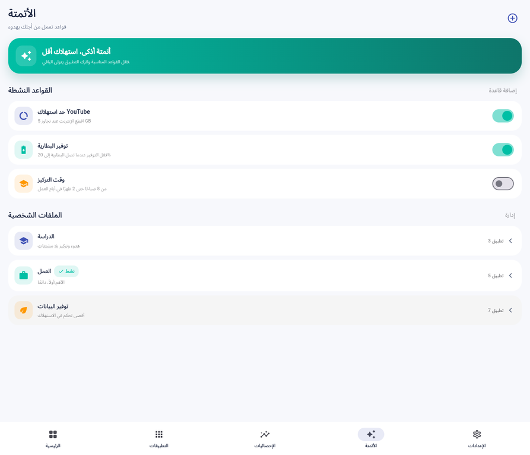
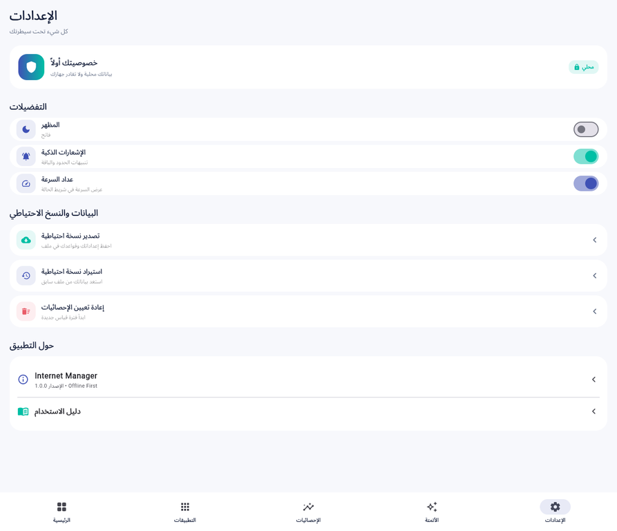

# الأدريسي نت | Alidrisi Net

> تطبيق Android لإدارة استهلاك الإنترنت والتحكم في التطبيقات من مكان واحد.

<p align="center">
  <a href="https://github.com/aladrisiaymenan-eng/Alidrisi-Net/releases/latest/download/Alidrisi-Net-arm64.apk"><strong>⬇️ تنزيل تطبيق الأدريسي نت ARM64</strong></a>
</p>

<p align="center">النسخة الحالية مخصصة لأجهزة Android الحديثة التي تدعم معمارية <code>arm64-v8a</code>.</p>

## عن التطبيق

يساعدك الأدريسي نت على فهم استهلاك الإنترنت بدل الاعتماد على التخمين. يعرض التطبيق استهلاك بيانات الجوال وWi‑Fi، ويوضح استخدام كل تطبيق، ويحفظ سجلًا يوميًا يمكن الرجوع إليه بعد أيام أو أسابيع. وعند اختيار تاريخ محدد، تظهر تفاصيل التطبيقات التي استخدمت الشبكة وقيمة استهلاك كل تطبيق.

بعد معرفة مصدر الاستهلاك، يمكنك اتخاذ إجراء واضح: تحديد حد يومي مخصص لتطبيق، تفعيل تنبيه عند الاقتراب من الحد، أو حجب الإنترنت عن تطبيق محدد، بما في ذلك حجب استخدامه أثناء عمله في الخلفية.

## أهم الميزات

| الميزة | الفائدة |
|---|---|
| السجل التاريخي اليومي | الرجوع إلى استهلاك الأيام السابقة حتى بعد مرور أسابيع |
| تفاصيل أي تاريخ | عرض إجمالي الجوال وWi‑Fi والمجموع لذلك اليوم |
| استهلاك كل تطبيق | معرفة التطبيقات التي استخدمت الإنترنت وقيمة استهلاك كل تطبيق |
| حد يومي لكل تطبيق | ضبط كمية استخدام مناسبة لتطبيق معين |
| الحجب الكامل | منع التطبيق المحدد من استخدام الإنترنت عند الحاجة |
| حجب الخلفية | منع التطبيق من استخدام الشبكة عندما يعمل في الخلفية |
| سياسات الشبكة | الاختيار بين الجوال وWi‑Fi والحجب وفق السياسة المتاحة |
| التنبيهات والقواعد | متابعة الاقتراب من الحدود وتطبيق قواعد الاستخدام |
| عداد السرعة | عرض سرعة التنزيل والرفع بصورة مباشرة |

## طريقة الاستخدام السريعة

1. ثبّت التطبيق وافتحه.
2. فعّل إذن **الوصول إلى بيانات الاستخدام** حتى يستطيع Android تزويد التطبيق بإحصاءات التطبيقات.
3. وافق على إذن **VPN** عند تفعيل الحجب؛ يستخدمه التطبيق لتطبيق سياسة الشبكة.
4. افتح قسم **الإحصائيات** ثم **السجل اليومي**.
5. اضغط على أي تاريخ لمشاهدة إجمالي الجوال وWi‑Fi وقائمة التطبيقات واستهلاك كل تطبيق.
6. لفرض حد أو حجب، افتح قسم **التطبيقات** واختر التطبيق والسياسة المناسبة.

## تنزيل التطبيق

### تنزيل مباشر

<a href="https://github.com/aladrisiaymenan-eng/Alidrisi-Net/releases/latest/download/Alidrisi-Net-arm64.apk">📥 اضغط هنا لتنزيل أحدث APK ARM64</a>

### متطلبات النسخة

هذه النسخة مبنية لمعمارية **ARM64 (`arm64-v8a`)**، وهي مناسبة لمعظم أجهزة Android الحديثة. لن تعمل على بعض الأجهزة القديمة التي تدعم ARM32 فقط أو الأجهزة ذات معمارية x86.

للتثبيت من خارج متجر Google Play، فعّل السماح بتثبيت التطبيقات من هذا المصدر عندما يطلب Android ذلك. نزّل APK من رابط الإصدار الرسمي في هذا المستودع فقط، وتحقق من بصمة SHA-256 المنشورة في صفحة الإصدار عند الحاجة.

## واجهات التطبيق

### لوحة التحكم الرئيسية

تعرض نظرة سريعة على الاستهلاك الحالي، الباقة، وسرعة الاتصال.



### التطبيقات واستهلاك كل تطبيق

تتيح شاشة التطبيقات معرفة التطبيقات المستخدمة للإنترنت وتطبيق سياسة مناسبة لكل تطبيق.



### الإحصائيات والسجل التاريخي

تعرض شاشة الإحصائيات سجل الاستخدام، مع إمكانية الرجوع إلى الأيام السابقة ومراجعة استهلاك الجوال وWi‑Fi.



### تفاصيل تاريخ محدد

عند الضغط على تاريخ محدد تظهر قيمة الاستهلاك الإجمالية، ثم قائمة التطبيقات التي استخدمت الإنترنت وقيمة استهلاك كل تطبيق.



### الحد اليومي والحجب لكل تطبيق

يمكن تحديد حد يومي مخصص لتطبيق، أو تفعيل الحجب الكامل أو سياسة الشبكة المناسبة عند الحاجة.



### القواعد والأتمتة

تساعد شاشة القواعد على تنظيم الاستخدام وتطبيق سياسات متكررة وفق الإعدادات التي يحددها المستخدم.



### الإعدادات والأذونات

تحتوي شاشة الإعدادات على خيارات الخدمات والأذونات اللازمة لقراءة الاستهلاك وتشغيل الحجب.



## ملفات المشروع

يحتوي مجلد `releases` على ملف APK الجاهز للتثبيت ونسخة المشروع المضغوطة. ويحتوي مجلد `assets` على الصور التسويقية ولقطات العرض المستخدمة في التعريف بالتطبيق.

## تشغيل المشروع للمطورين

المصدر المضغوط متاح في `releases/Alidrisi_Net_source.zip`. بعد فك الضغط، راجع ملف دليل التشغيل على VS Code داخل المشروع، ثم نفّذ:

```bash
flutter pub get
flutter analyze
flutter test
flutter run
```

لبناء نسخة ARM64:

```bash
flutter build apk --release --split-per-abi --target-platform android-arm64
```

## الخصوصية والأذونات

يحتاج عرض إحصاءات التطبيقات إلى إذن Android الخاص ببيانات الاستخدام، ويحتاج الحجب إلى إذن VPN. لا تمنح هذه الأذونات إلا للتطبيق الذي تثق به، وراجع إعدادات Android إذا أردت إيقاف الخدمة أو سحب الإذن.

## ملاحظات مهمة

تختلف دقة إحصاءات الشبكة وسلوك الخدمات الخلفية حسب إصدار Android والشركة المصنعة للجهاز. قد لا يعمل الحجب إذا كان هناك VPN آخر نشط، لأن Android يسمح عادةً بمسار VPN واحد للمستخدم في الوقت نفسه. لا يضمن التطبيق توفير نسبة ثابتة من الباقة؛ بل يمنحك بيانات وأدوات تساعدك على اتخاذ قرارات أفضل.

## الترخيص والتواصل

أضف معلومات الترخيص ووسيلة التواصل الرسمية هنا قبل نشر المستودع على نطاق واسع.

## الإصدار الحالي — v1.1.1

- **APK مباشر:** [تنزيل Alidrisi-Net-arm64.apk](https://github.com/aladrisiaymenan-eng/Alidrisi-Net/releases/download/v1.1.1/Alidrisi-Net-arm64.apk)
- **صفحة الإصدار:** [v1.1.1 على GitHub](https://github.com/aladrisiaymenan-eng/Alidrisi-Net/releases/tag/v1.1.1)
- **المعمارية:** `arm64-v8a`
- **الحجم التقريبي:** 22.5 MB
- **SHA-256:** `7cdaf0b195531fbddcf9d597e53fe97ffc3c9473b6c593a28554d36c8ba0eb78`
- **مصدر المشروع:** `releases/Alidrisi_Net_source.zip`
- **تقرير الإصلاح:** `releases/تقرير_إصلاح_استمرارية_الأدريسي_نت.md`

تم في هذا الإصدار إصلاح استعادة خدمات الخلفية وسياسات VPN بعد إعادة التشغيل، وإضافة تعافٍ لعداد السرعة، مع استمرار قراءة الاستخدام كل ثانيتين.
